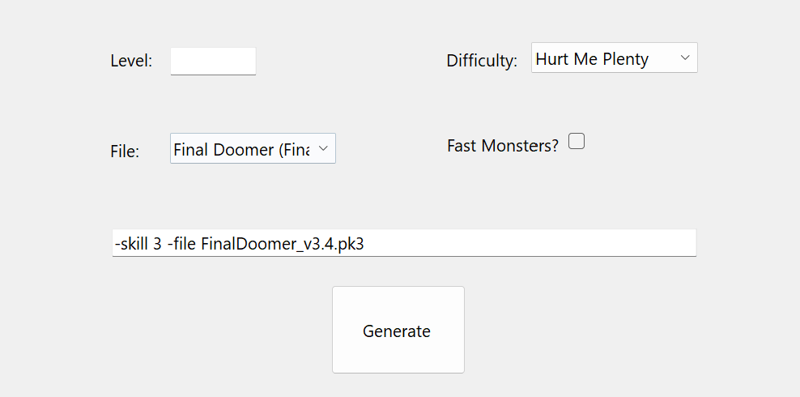
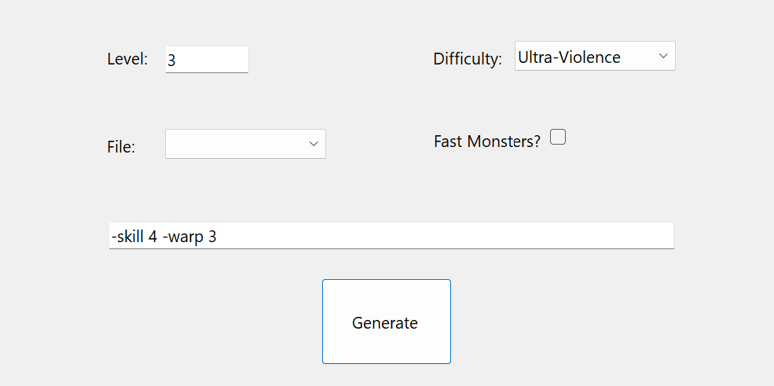
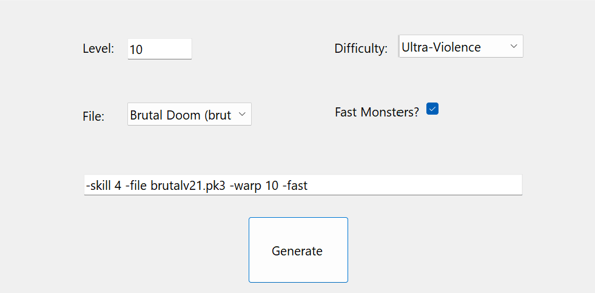

# UZDoomParameterHelper

A small windows forms program to help generate additional parameters for UZDoom.

The current options available are:
- Level
- Difficulty
- Mod File
- Fast Monsters

## Prerequisites 

- Windows
- [.NET 10](https://dotnet.microsoft.com/en-us/download/dotnet/10.0)
- [UZDoom](https://zdoom.org/downloads) (Technically not required)
- If you want to use any mods in the file list, make sure you have them named
correctly in the same directory as the UZDoom executable.

## How do I run this?

### Visual Studio
1. Clone the repository
2. Open the solution in Visual Studio
3. Run it

### Command Line

From root of repository, run:
```
dotnet run --project .\UZDoomParameterHelper\UZDoomParameterHelper.csproj
```
## Screenshots



